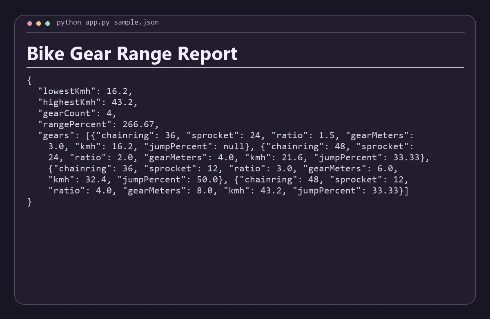

# Bike Gear Range Report

Compare bicycle drivetrain ratios, speed at a chosen cadence, and the gaps between gears.



## Run

Install Python 3.11 or newer. Run these commands from the repository root.

```sh
python app.py sample.json
```

Replace `sample.json` with a JSON file following the same structure. The app prints a JSON report to standard output.

Provide positive tooth counts, wheel rollout in meters and cadence in revolutions per minute. Each listed combination is theoretical. Consult your drivetrain limits before using a particular cross-chain combination.

## Verify

Run `python check.py` with Python 3.11 or newer after the build step when applicable. The check verifies the bundled scenario and confirms that an invalid input returns an error.
